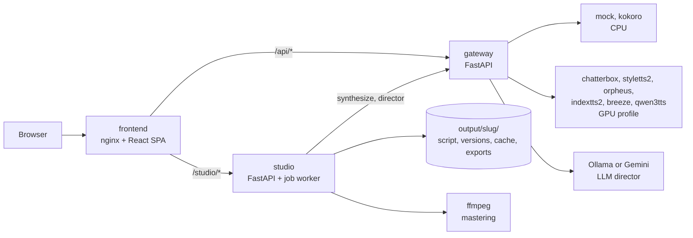

# Audiobook Studio

Turn a book into a chaptered, loudness-mastered audiobook with open-source TTS engines you run yourself, and direct the performance line by line.

Audiobook Studio is a self-hosted workspace for producing audiobooks with local text-to-speech. It ingests a `.txt`, `.md` or `.epub` file into an editable Book Script, attributes dialogue to speakers, casts voices, lets an LLM "director" (local Ollama or Gemini) propose performance notes that you review before they touch the book, renders through a content-hash cache, and exports a chaptered `.m4b` or an ACX-shaped MP3 pack. Every TTS engine runs as its own Docker microservice behind one HTTP contract, and a bake-off lab compares engines side by side on the same text. It is for people who want to experiment with open TTS models for long-form narration on their own hardware, and it is built as a single-user tool for a local machine.


**No hosted demo.** The real thing needs TTS engines and, for most of them, an NVIDIA GPU. The UI runs on demo data with no backend at all (`VITE_MOCK=1`, see [Getting started](#getting-started)), and the whole stack runs with no model through its offline modes.

## Contents

- [Features](#features)
- [Engines and hardware](#engines-and-hardware)
- [Engineering highlights](#engineering-highlights)
- [Tech stack and design decisions](#tech-stack-and-design-decisions)
- [Getting started](#getting-started)
- [Configuration](#configuration)
- [Tests, lint and CI](#tests-lint-and-ci)
- [Security and limitations](#security-and-limitations)
- [License](#license)
- [Author](#author)

## Features

- **A shelf of books, each a versioned workspace.** Paste text or upload `.txt`, `.md` or `.epub`. The book type (fiction, poetry, nonfiction, technical and others) is detected and picks a production profile: narrator voice, pace, pause budget, verse or prose chunking, and what to strip (page numbers, citations, footnote markers). Front matter such as a copyright page is kept out of the audio.
- **Speaker attribution that admits doubt.** Each dialogue line records how it was attributed (`tag`, `continuation`, `pronoun`, `alternation`) and a confidence. Below 0.5 it becomes `Unknown`, which the desk can filter for, instead of a confident wrong voice.
- **Hybrid casting.** Narration on a steady engine (Kokoro), characters on an expressive one, per character and stable across chapters. A book that routes any line to an engine with non-commercial weights carries a licence note on the shelf and the desk.
- **The Director's Desk.** The script is the document: every line shows its speaker, its performance note, and whether its audio is `cached`, `stale` or `missing`. Edit a note and exactly that line goes stale; re-render one line in place, or only the stale ones. QC tools include filters, flags with notes, per-line playback, playback speed, speaker reassignment and per-chapter sign-off. Long chapters use a windowed list.
- **An LLM director you review before it acts.** A director pass reads the book scene by scene and proposes a written note, a pace and inline vocal events such as `(sigh)` for engines that understand them. The review screen shows each scene as kept, rejected or ignored; a rejected scene shows a word diff of the book text against what the model returned. Applying a pass never overwrites a line you directed by hand.
- **Pronunciation lexicon,** per book and global, applied before the cache key so an edit re-renders exactly the lines it touches.
- **Background jobs** for render, direct and export, with live progress over server-sent events, pause, resume and cancel. A job interrupted by a restart can be resumed.
- **Mastering and export.** Two-pass EBU R128 loudness normalisation, 44.1 kHz, chaptered `.m4b`, `.mp3` or `.wav`, or an ACX submission shape: one 192 kbps CBR MP3 per chapter with room tone, a limiter, a split before the 120-minute ceiling and a measured compliance table per file.
- **A bake-off lab** (`/lab`): the same passage through several engines side by side, with each engine's controls rendered from the capabilities it declares, timing per result, and a button to free an engine's VRAM.
- **Runs with no model.** `STUDIO_OFFLINE=1` swaps in a fake synthesizer and `STUDIO_FAKE_DIRECTOR=1` a canned director. The job kinds, pass shapes and cache keys are the real ones, and fake audio is cached in its own folder so it is never served as real speech.


## Engines and hardware

Model weights are never stored in this repository. Each engine downloads its own weights on first use (from Hugging Face, into the shared cache `HF_CACHE_DIR`), except IndexTTS2 and Breeze TTS 2, whose checkpoints you download once into `./models/` (commands in [Getting started](#getting-started)). The `mock` engine has no weights.

| Engine | Adds | Runs on | Weight licence or terms (source, date checked) |
|---|---|---|---|
| `mock` | sine-tone generator for testing the stack | CPU | no weights |
| `kokoro` (Kokoro-82M) | steady narrator, named voices | CPU | Apache-2.0 (model card metadata, 2026-10-02) |
| `chatterbox` | zero-shot cloning, one expressiveness knob | GPU | MIT (model card metadata, 2026-10-02) |
| `styletts2` | long-form prosody, style from a reference clip | GPU | Code MIT. The pretrained models' terms require telling listeners the speech is synthesized unless you have permission to use the voice (upstream README, 2026-10-02) |
| `orpheus` (Orpheus 3B) | built-in voices, inline emotion tags | GPU, vLLM | Apache-2.0 per the model card (2026-10-02). The checkpoint is fine-tuned from Llama-3.2-3B-Instruct, so the Llama 3.2 Community License may also apply (**unverified**). Gated on Hugging Face; needs a token |
| `indextts2` | emotion labels, emotion reference clip, written emotion text | GPU | bilibili Model Use License Agreement (upstream repository, 2026-10-02); its commercial terms are **unverified** here |
| `breeze` (Breeze TTS 2) | written performance notes, inline vocal events, cloning | GPU | **BreezeBlue Research and Non-Commercial License, which also covers self-hosted output** (upstream README, quoted in [`engines/breeze/README.md`](engines/breeze/README.md)) |
| `qwen3tts` (Qwen3-TTS 1.7B CustomVoice) | nine named voices, written performance notes | GPU | Apache-2.0 per the model card metadata, checked 2026-09-26 ([`engines/qwen3tts/README.md`](engines/qwen3tts/README.md)) |

These are summaries of what each source says, not legal advice; read the model card or licence yourself before using any output beyond personal experiments. Anything rendered through Breeze is for evaluation and personal use only.

**Hardware.** This project was developed on an 8 GB RTX 3060. Kokoro runs on the CPU, and Qwen3-TTS was measured on that card at +4,860 MiB while loaded (method and numbers in [`engines/qwen3tts/README.md`](engines/qwen3tts/README.md)). **IndexTTS2, Orpheus and Breeze TTS 2 need more VRAM than an 8 GB card comfortably offers:** Breeze's upstream README recommends 12 GB (about 7.7 GiB in eager mode, quoted in [`engines/breeze/README.md`](engines/breeze/README.md)), and this repository has no VRAM measurement for Orpheus or IndexTTS2, so plan on a larger card for both. Breeze and Orpheus have never been run on real weights in this project. GPU engines load lazily (no VRAM until their first synthesis), and `BAKEOFF_CONCURRENCY=1` with `BAKEOFF_UNLOAD=1` runs a bake-off one engine at a time, freeing each model after its turn. Breeze can also be driven on a bigger machine over HTTP (`BREEZE_SERVER_URL`).

## Engineering highlights

1. **One HTTP contract; the gateway never imports an engine.** An engine implements `TTSEngine` (`info`, `_load`, `synthesize`) and [`shared/engine_base.py`](shared/engine_base.py) turns it into a FastAPI app with `/health`, `/info`, `/synthesize` and `/unload`, lazy loading, and a lock so a VRAM unload can never free a model mid-synthesis. Each engine builds its own image, because each pins a different PyTorch (2.4.1, 2.6.0, 2.9.1, or vLLM's). The gateway discovers engines from a registry, proxies synthesis and fans bake-offs out; the UI renders only the controls an engine declares. Adding an engine to the gateway and the lab is a folder, a compose service and one registry line.
2. **The director cannot quietly rewrite the book.** An LLM asked to insert `(sigh)` into a passage sometimes paraphrases it, and a paraphrase that ships is a wrong audiobook that still sounds fine. So an annotated passage is kept only if removing its allowed tags reproduces the source exactly (whitespace aside), after near-miss spellings such as `[sigh]` are canonicalised. A failure keeps the model's text and a reason (paraphrase, unknown tag, truncation) for the review screen. Tagged text reaches only engines that advertise those tags, and a written note only engines that declare they take one. See [`gateway/app/services/director.py`](gateway/app/services/director.py) and [`pipeline/direct.py`](pipeline/direct.py).
3. **The cache key is the interface.** Each line's audio is cached under a SHA-256 of everything that changes what the engine produces: the exact string it is sent (inline tags and lexicon respellings applied), the note, the voice description, the voice, the engine, the speed and the schema version. A line's `cached`/`stale`/`missing` state is derived by recomputing that key, never stored, so there is no dirty flag to forget. New fields join the hash only when set, so older books keep their caches. See [`pipeline/render.py`](pipeline/render.py) and [`pipeline/studio/store.py`](pipeline/studio/store.py).
4. **Jobs are files.** One worker thread runs render, direct and export jobs. Each record is written atomically after every step and re-read at startup, where a `running` job becomes `interrupted` and can be resumed; pause and cancel are flags checked between lines, never a killed thread that could leave a half-written cache entry. The UI follows progress over SSE and reconnects with backoff. See [`pipeline/studio/jobs.py`](pipeline/studio/jobs.py).
5. **Mastering to a delivery shape, then measuring it.** Export runs ffmpeg's two-pass `loudnorm` (measure, then apply a linear gain toward −19 LUFS / −3 dBTP), resamples to 44.1 kHz and writes chapter markers. The ACX format adds per-chapter 192 kbps CBR MP3s, generated room tone, a limiter, a split before 120 minutes and a compliance table measured from the output files. See [`pipeline/master.py`](pipeline/master.py).
6. **The UI is typed against the API it calls.** The studio's OpenAPI is exported to [`docs/studio-openapi.json`](docs/studio-openapi.json), `openapi-typescript` generates the frontend schema, and a conformance file fails `tsc` when the hand-written client types drift. A parity test validates the mock API's responses against the same schemas with Ajv, so mock-mode screens are wire-shaped. Playwright runs every route on the mock with axe.

## Tech stack and design decisions



- **Gateway: FastAPI with async httpx.** Bake-off concurrency defaults to 1 because concurrent model loads are what exhaust a shared GPU. The director prompt is a Markdown file re-read when it changes ([`gateway/app/prompts/director.md`](gateway/app/prompts/director.md)), and the director model is configuration (`DIRECTOR_MODEL`), never hard-coded, because an 8 GB and a 48 GB machine want different directors.
- **Studio: FastAPI over plain folders.** A book is a directory with `book.json`, an append-only series of script versions, passes, job records, the render cache and exports. No database; everything a job needs survives a restart. The contract is written down in [`docs/STUDIO-API.md`](docs/STUDIO-API.md).
- **Pipeline: deliberately dependency-light.** Python standard library plus pydantic for the Book Script, EbookLib and BeautifulSoup for EPUB, and ffmpeg through `subprocess` for mastering. Parsing, attribution, casting and the cache need no model, which is why the whole pipeline is testable offline.
- **Frontend: React 18, React Router 7, Vite 6, strict TypeScript.** The studio screens use one token-based stylesheet with light and dark values; the older bake-off lab still uses Tailwind. Server data goes through one `StudioApi` interface with a real and a mock implementation, injected by context, so mock mode exercises the same screens.
- **Docker Compose, GPU engines behind a profile.** The default stack (gateway, studio, frontend, mock, Kokoro) needs no GPU; `--profile gpu` adds the six GPU engines.

```text
shared/                  the engine contract: schemas, TTSEngine base, app factory
gateway/                 FastAPI gateway: engine discovery, synthesis proxy, bake-off, LLM director
  app/prompts/           the director's system prompt (hot-reloaded)
engines/<name>/          one microservice per TTS engine (Dockerfile, adapter, tests where offline-testable)
pipeline/                ingest, classify, clean, attribute, cast, build, direct, lexicon, render, master
  studio/                the studio service: book store, job queue, API routes
  samples/               short original sample texts and a generated sample EPUB
  player/                self-contained read-along web player
frontend/                the Director's Desk (React) and the bake-off lab; Vitest, ESLint, Playwright
scripts/                 director tuning, OpenAPI export, Qwen3-TTS smoke test, direction A/B harness
docs/                    API contract, OpenAPI export, audits, the direction experiment, screenshots
docker-compose.yml       the stack; GPU engines under the `gpu` profile
.github/workflows/ci.yml Python suites and the frontend checks
```

## Getting started

### Docker (recommended)

Requires Docker with Compose. The default stack needs no GPU.

```bash
git clone https://github.com/jadrianlg16/audiobook-studio.git
cd audiobook-studio
cp .env.example .env
docker compose up --build
```

- Director's Desk: <http://localhost:5173> (the bake-off lab is at `/lab`)
- Gateway API docs: <http://localhost:8080/docs>
- Studio API docs: <http://localhost:5174/docs>

With the shipped `.env.example`, renders go to the real Kokoro engine, which downloads its weights (about 330 MB) on first use, and director passes call Ollama on the host (`OLLAMA_URL`). To try everything with nothing downloaded, set `STUDIO_OFFLINE=1` and `STUDIO_FAKE_DIRECTOR=1` in `.env` first. Books are stored in `./output/`.

For the GPU engines you need an NVIDIA GPU and the NVIDIA Container Toolkit (on Windows, Docker Desktop with the WSL 2 backend):

```bash
# Checkpoints that are bind-mounted rather than fetched on first use:
huggingface-cli download IndexTeam/IndexTTS-2 --local-dir ./models/IndexTTS-2
huggingface-cli download BreezeBlue/Breeze-TTS-2 --local-dir ./models/breeze-tts-2

docker compose --profile gpu up --build
```

Orpheus also needs `HUGGING_FACE_HUB_TOKEN` in `.env` after you accept its licence on Hugging Face.

### Local development

Requires Python 3.11, Node.js 20 or newer, and ffmpeg on `PATH` for export.

```bash
python3.11 -m venv .venv            # Windows: py -3.11 -m venv .venv
source .venv/bin/activate           # Windows PowerShell: .venv\Scripts\Activate.ps1
pip install -r gateway/requirements.txt -r pipeline/requirements.txt numpy

# Gateway, with only the offline mock engine registered:
python -m uvicorn engines.mock.main:app --port 8001 &
ENGINES="mock=http://127.0.0.1:8001" python -m uvicorn gateway.app.main:app --port 8080 &

# Studio service, with the fake synthesizer and director:
STUDIO_OFFLINE=1 STUDIO_FAKE_DIRECTOR=1 python -m uvicorn pipeline.webapp:app --port 5174 &

# UI (proxies /api to :8080 and /studio to :5174; override with VITE_GATEWAY / VITE_STUDIO):
cd frontend && npm ci && npm run dev
```

To look at the UI with demo data and no backend at all: `cd frontend && npm ci && VITE_MOCK=1 npm run dev`.

The pipeline also works as a command-line tool:

```bash
python -m pipeline.generate pipeline/samples/sample.txt --title "The Cold Lantern" --out output/cold-lantern --offline
cd output/cold-lantern && python -m http.server 8100   # then open http://localhost:8100/player.html
```

Drop `--offline` to render through a running gateway (`--gateway`, default `http://localhost:8080`). More in [`pipeline/README.md`](pipeline/README.md).

## Configuration

All variables are optional; `.env.example` documents each one.

| Variable | Default | Purpose |
|---|---|---|
| `FRONTEND_PORT`, `GATEWAY_PORT`, `STUDIO_PORT` | `5173`, `8080`, `5174` | Host ports. |
| `HF_CACHE_DIR` | `./hf-cache` | Where engines cache downloaded weights. |
| `ENGINES` | the compose services | Override engine discovery: `id=url;id=url`. |
| `BAKEOFF_CONCURRENCY` | `1` | Engines synthesized in parallel in a bake-off. |
| `BAKEOFF_UNLOAD` | `0` (`.env.example` sets `1`) | Free each engine's model after its bake-off synthesis. |
| `REQUEST_TIMEOUT` | `1800` | Gateway timeout for a synthesis, in seconds. |
| `OLLAMA_URL` | `http://host.docker.internal:11434` | Ollama for the director. |
| `GEMINI_API_KEY` | empty | Optional; the lab can also send a key per request. |
| `DIRECTOR_MODEL` | `llama3.2` (gateway) | Default director model. |
| `DIRECTOR_PROMPT_PATH` | built-in prompt | A variant prompt file to compare against. |
| `STUDIO_OFFLINE`, `STUDIO_FAKE_DIRECTOR` | `0` | `1` = fake synthesizer / canned director. |
| `STUDIO_NARRATOR_ENGINE`, `STUDIO_EXPRESSIVE_ENGINE`, `STUDIO_CASTING_MODE` | `kokoro`, `breeze`, `narrator_only` | Defaults for a new book; editable in Settings. |
| `HUGGING_FACE_HUB_TOKEN` | empty | Gated checkpoints (Orpheus). |
| `BREEZE_SERVER_URL`, `BREEZE_FAST` | empty, `0` | Drive a remote Breeze server; Breeze's faster, larger mode. |
| `QWEN_TTS_MODEL`, `QWEN_TTS_DEFAULT_VOICE` | 1.7B CustomVoice, `aiden` | Qwen3-TTS checkpoint and default voice. |

## Tests, lint and CI

```bash
pip install -r gateway/requirements.txt -r pipeline/requirements.txt -r engines/breeze/requirements.txt numpy==2.2.1
python -m pytest -q -rs gateway/tests engines/breeze/tests engines/indextts2/tests engines/qwen3tts/tests pipeline/tests

cd frontend
npm ci
npm run check                 # generated-types freshness, typecheck, ESLint, Prettier, Vitest, build
npm run e2e -- --workers=1    # Playwright smoke + axe on every route, against the mock
```

None of the tests needs a GPU, a model, Ollama or network access. The gateway is tested with an in-memory fake engine; the studio and pipeline with the offline fake synthesizer and director; the Breeze adapter against a stub that speaks Breeze's documented HTTP contract; the Qwen3-TTS and IndexTTS2 adapters with fake `torch`, `qwen_tts` and model objects. Mastering tests need ffmpeg and skip without it.

Results from a clean checkout on Windows 11 with Python 3.11.9 and Node.js 20.10 (2 October 2026):

- **Python:** 442 passed, 1 skipped. The skip is the OpenAPI export's freshness check, which only runs under the FastAPI and Pydantic versions that produced the committed export (0.133.1 and 2.13.4, newer than the pinned ones); under those versions it passes.
- **Frontend `npm run check`:** 16 test files, 130 tests passed; ESLint 0 errors and 8 accessibility warnings; production build succeeds.
- **Playwright** (`--workers=1`, installed Chrome): 28 passed: a smoke and axe check on each of 21 routes, 6 desk interaction tests and 1 error-boundary test.
- **Docker:** the five default-profile images (gateway, studio, frontend, mock, Kokoro) build. With `STUDIO_OFFLINE=1` and `STUDIO_FAKE_DIRECTOR=1`, a sample book was created, rendered, directed, applied, re-rendered and exported to a chaptered `.m4b` through the nginx front door, and a mock-engine bake-off ran through the gateway. The six GPU images were not built for this check.

The e2e run writes its axe summary to `test-results/`; `AXE_BASELINE_UPDATE=1 npm run e2e` refreshes the committed baseline in `frontend/e2e/axe-baseline.md`. Run the Playwright suite locally with one worker on Windows: parallel page loads there can fail with `net::ERR_NO_BUFFER_SPACE`, a host networking limit rather than an app bug.

[`ci.yml`](.github/workflows/ci.yml) runs the Python suites (with ffmpeg installed, so the mastering tests run) and the frontend check plus the Playwright run on every pull request and on pushes to `main`. The GPU engines' images are not built in CI.

## Security and limitations

**This is a single-user tool for your own machine. It has no authentication, the gateway allows any origin by default, and it should not be exposed to the internet.**

- **The director's value is unproven.** The blind A/B listening test that should decide whether the director's notes make narration better has not been scored by a listener. [`scripts/direction_ab.py`](scripts/direction_ab.py) is the experiment harness and [`docs/experiments/direction-ab/`](docs/experiments/direction-ab/README.md) describes the method; nothing here claims the director improves narration.
- **Engines not run on real weights here:** Breeze TTS 2 (below its recommended VRAM; its adapter is tested against a stub of its HTTP API, and [`docs/BREEZE-AUDIT-2026-09-05.md`](docs/BREEZE-AUDIT-2026-09-05.md) reconciles every claim against the upstream source) and Orpheus (gated, and above 8 GB). IndexTTS2's mapping of a written note to its `emo_text` input is untested on weights.
- **Licences.** See [Engines and hardware](#engines-and-hardware). Orpheus's Llama-derived terms and IndexTTS2's commercial terms are not verified, StyleTTS2's pretrained models require disclosing synthetic speech, and Breeze's weights forbid commercial use of their output.
- **Data leaving the machine.** Only if you choose the Gemini provider: the passage is sent to Google's API with your key, which the gateway takes per request or from `GEMINI_API_KEY` and does not store. Ollama and every engine run locally.
- **Heuristics, not understanding.** Speaker attribution is rule-based and abstains to `Unknown` when unsure; a name-only action beat (`Alex shrugged. "…"`) still abstains. Genre detection is heuristic unless you opt into the LLM classifier.
- **Scope.** No PDF ingest. ACX exports lack credits, a retail sample and cover art. Render-cache disk usage on a full-length book has not been measured. The text pipeline (sentence splitting, attribution, casting) is written for English.
- **Frontend.** The [frontend audit](docs/FRONTEND-AUDIT-2026-09-26.md) lists what is still open: TanStack Query, a design-system pass (the lab still uses Tailwind) and an accessibility pass. axe in the e2e run currently fails only on critical violations.

## License

Copyright © 2026 Adrián Gaona. All rights reserved. The source is public so it can be read and evaluated; no license is granted to reuse or redistribute it.

Model weights are not part of this repository and keep their own licences, listed in [Engines and hardware](#engines-and-hardware); Breeze TTS 2's weights are research and non-commercial, including their self-hosted output. Notable copyleft components: EbookLib (AGPL-3.0-or-later) in the studio service, ffmpeg (LGPL-2.1-or-later or GPL, depending on the build) in the studio image and several engine images, and espeak-ng (GPL-3.0) in the Kokoro and StyleTTS2 images. Each engine image also installs its model's own inference package (kokoro, chatterbox-tts, styletts2, orpheus-speech with vLLM, index-tts, qwen-tts, and BreezeBlue's Apache-2.0 inference code), each under its own licence. The other direct dependencies of the gateway, studio and frontend use MIT, BSD, Apache-2.0 or similar licences; axe-core, used only in end-to-end tests, is MPL-2.0.

## Author

**Adrián Gaona** · [adriangaona.dev](https://www.adriangaona.dev) · [LinkedIn](https://www.linkedin.com/in/jesus-lopez-95762b2b6) · [GitHub](https://github.com/jadrianlg16)
